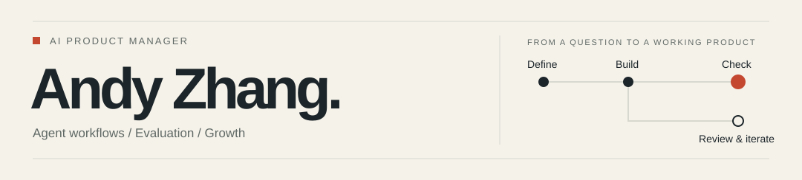
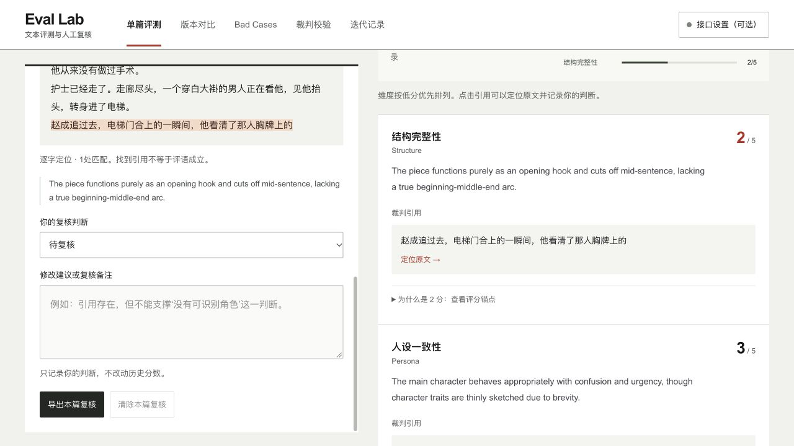
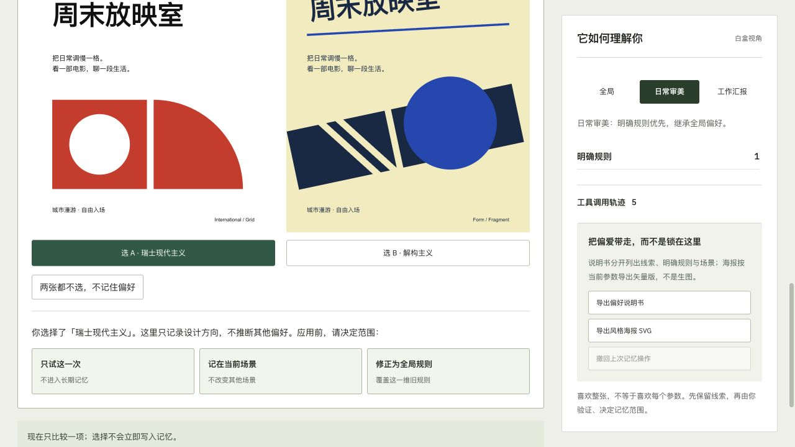
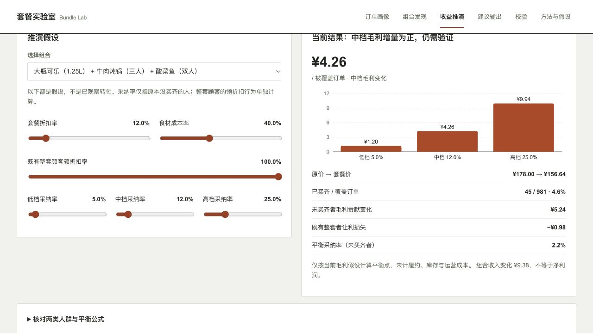

<picture>
  <source media="(prefers-color-scheme: dark)" srcset="assets/profile-dark.svg">
  
</picture>

# Andy Zhang · 张千羽

**AI Product Manager working on Agents, evaluation and growth.**

I turn business questions into usable products, then check whether they solve the problem. These four projects make the decisions inspectable.

[Portfolio & full demos](https://andyzhang666666.github.io/) · [Product CV, Chinese](https://andyzhang666666.github.io/assets/resume.pdf) · [中文](README.md) · [All projects](PROJECTS.en.md)

## Start here

<table>
<tr>
<td width="50%" valign="top">

<strong>Agent Execution Bench</strong> After a lost response, check the original operation.

<a href="https://andyzhang666666.github.io/agent-bench/"><picture><source media="(prefers-reduced-motion: reduce)" srcset="docs/assets/agent-preview.jpg"></picture></a>

Recorded program example · no model call <a href="https://andyzhang666666.github.io/agent-bench/">Try it</a> · <a href="https://github.com/AndyZhang666666/AndyZhang666666.github.io/tree/main/agent-bench">Source & decisions</a>

</td>
<td width="50%" valign="top">

<strong>Eval Lab</strong> Follow the score back to the source and human review.

Historical output · original score retained <a href="https://andyzhang666666.github.io/llm-output-eval/">Try it</a> · <a href="https://github.com/AndyZhang666666/llm-output-eval">Source & decisions</a>

</td>
</tr>
<tr>
<td width="50%" valign="top">

<strong>TasteRoom</strong> Compare designs, then choose where a preference applies.

Local rules · explicit scope consent <a href="https://andyzhang666666.github.io/tasteroom/">Try it</a> · <a href="https://github.com/AndyZhang666666/AndyZhang666666.github.io/tree/main/tasteroom">Source & decisions</a>

</td>
<td width="50%" valign="top">

<strong>Bundle Lab</strong> Separate new contribution from discount leakage.

Synthetic orders · conditional model <a href="https://andyzhang666666.github.io/bundle-lab/">Try it</a> · <a href="https://github.com/AndyZhang666666/bundle-lab">Source & decisions</a>

</td>
</tr>
</table>

[Static Agent image](docs/assets/agent-preview.jpg). The animation steps through program records; its pauses are presentation timing, not execution latency.

### Agents and evaluation

[Agent Execution Bench](https://github.com/AndyZhang666666/AndyZhang666666.github.io/tree/main/agent-bench), [Trustworthy RAG Lab](https://github.com/AndyZhang666666/AndyZhang666666.github.io/tree/main/rag-lab) and [Eval Lab](https://github.com/AndyZhang666666/llm-output-eval) examine different questions: did the action happen, does the evidence apply, and is the output any good?

Agent Bench uses ten fictional ticket cases to inspect permissions, recovery and duplicate writes. RAG Lab changes the date, source snapshot and accessible scope for the same question, then shows the applicable answer and passage. Eval keeps the original judge output and leaves room for disagreement.

[Try RAG Lab](https://andyzhang666666.github.io/rag-lab/) · [Retrieval and version-selection code](https://github.com/AndyZhang666666/AndyZhang666666.github.io/blob/main/rag-lab/engine.mjs) · [Filing facts and omissions](https://github.com/AndyZhang666666/filing-eval)

### Everyday products

**[TasteRoom](https://andyzhang666666.github.io/tasteroom/)** turns aesthetic exploration into comparison, attribution and explicit consent. Swiss modernist and deconstructed compositions are editable directions. Liking one poster does not become a preference for every context.

**[Suibianju](https://andyzhang666666.github.io/suibianju/)** helps a group get past “anything is fine.” When no option meets everyone's conditions, a voluntary change is previewed before each person accepts the conditions and shared proposal. **[Grounded Choice](https://andyzhang666666.github.io/grounded-choice/)** keeps agreements, conflicting experiences and personal constraints visible while the user makes the choice.

### Growth and monetisation

| Tool | Product question | Implementation |
| --- | --- | --- |
| [Bundle Lab](https://github.com/AndyZhang666666/bundle-lab) · [Demo](https://andyzhang666666.github.io/bundle-lab/) | Does a frequent combination deserve a discount? | Basket discovery, a two-population ledger, break-even analysis and a test plan. |
| [Growth Experiment Lab](https://github.com/AndyZhang666666/growth-experiment-lab) · [Demo](https://andyzhang666666.github.io/growth-experiment-lab/) | Does a significant result justify rollout? | Experiment planning, peeking-risk simulation, guardrails and a human release decision. |
| [Pricing Model Sim](https://github.com/AndyZhang666666/pricing-model-sim) · [Demo](https://andyzhang666666.github.io/pricing-model-sim/) | Which payment mechanism suits the same starting cohort? | Conserved populations, monthly revenue traces, assumption sweeps and discounted payback. |

## Work in practice

At Shanhai Xingchen, I own creative Agent workflows and Skill assets: 38 Skills shipped, around 6,000 tool calls per month and roughly 30% less creation time per drama. During my Baidu internship, I helped launch an AI feature that passed 10,000 daily active users within two weeks. At Meituan Keeta, segmented subsidy experiments reduced new-customer acquisition cost by 27% and increased new-customer monthly retention by 8%. I also interned on Li Auto's smart cockpit and Revolut's subscription products.

[Responsibilities and measurement context](https://andyzhang666666.github.io/#work) · [Product CV, Chinese](https://andyzhang666666.github.io/assets/resume.pdf)

These are work outcomes. The public repositories contain independent projects, with simulated material, historical model outputs and conditional calculations labelled separately. They contain no employer code or internal business data. Public Agent / RAG demos use recorded program executions and browser retrieval respectively; live-model use requires local configuration.

## Further work

[AI Product Teardowns](https://github.com/AndyZhang666666/ai-product-teardowns) compares capability boundaries, failure handling and payment moments. [Commute Compare](https://github.com/AndyZhang666666/commute-compare) and the [poker modelling tools](PROJECTS.en.md#everyday-decisions-and-modelling) explore risk and assumptions. [Creative Eval](https://github.com/AndyZhang666666/creative-eval) preserves the first Eval iteration and its calibration history.

Master's studies at UCL; undergraduate Electrical and Electronic Engineering at Bristol. My research includes an order-flow-based intraday trading model and a wearable posture-monitoring system with a mobile interface.

[Get in touch](https://andyzhang666666.github.io/#contact) · [中文](README.md) · [Browse all projects](PROJECTS.en.md)
