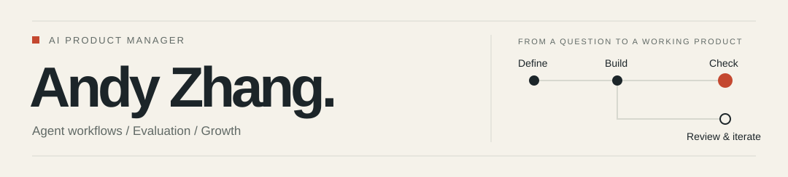

<picture>
  <source media="(prefers-color-scheme: dark)" srcset="assets/profile-dark.svg">
  
</picture>

# Andy Zhang · 张千羽

**AI Product Manager working on Agents, evaluation and growth.**

I turn business questions into usable products, then check whether they solve the problem. These four projects show decisions about evaluation, preferences, commercial trade-offs and evidence.

[Portfolio & full demos](https://andyzhang666666.github.io/) · [Product CV, Chinese](https://andyzhang666666.github.io/assets/resume.pdf) · [中文](README.md) · [All projects](PROJECTS.en.md)

## Start here

<table>
<tr>
<td width="50%" valign="top">

<strong>Eval Lab</strong> What supports the next revision?

Compare saved drafts, inspect exact changes and take the current version for reassessment.

Manual review / historical outputs kept separate <a href="https://andyzhang666666.github.io/llm-output-eval/workspace/">Try it</a> · <a href="https://github.com/AndyZhang666666/llm-output-eval/blob/main/docs/TASK-LOOPS-20261111.md">Design</a> · <a href="https://github.com/AndyZhang666666/llm-output-eval">Source</a> · <a href="https://github.com/AndyZhang666666/llm-output-eval/blob/af60f5b096bfd4e09ef0e5c94d5f8a93f44a1b40/docs/assets/task-loops-20261111/static/workspace-diff-1280.png">Full image</a>

</td>
<td width="50%" valign="top">

<strong>TasteRoom</strong> Where should a preference apply?

Compare personal and work rules on the same copy and image, then choose its scope.

Local design rules / comparison saves no preference <a href="https://andyzhang666666.github.io/tasteroom/">Try it</a> · <a href="https://github.com/AndyZhang666666/AndyZhang666666.github.io/blob/main/tasteroom/docs/TASK-LOOP-20261111.md">Design</a> · <a href="https://github.com/AndyZhang666666/AndyZhang666666.github.io/tree/main/tasteroom">Source</a> · <a href="https://github.com/AndyZhang666666/AndyZhang666666.github.io/blob/174399eef34fcdaae22926585dcf9066d1a283bb/tasteroom/docs/evidence/task-loop-20261111/scene-desktop.png">Full image</a>

</td>
</tr>
<tr>
<td width="50%" valign="top">

<strong>Bundle Lab</strong> Can selling more earn less?

Use your products or CSV, separate new contribution from discount leakage and freeze a test plan.

Synthetic orders / personal inputs / conditional model <a href="https://andyzhang666666.github.io/bundle-lab/simulate/">Try it</a> · <a href="https://github.com/AndyZhang666666/bundle-lab/blob/main/docs/TASK-LOOP-20261111.md">Design</a> · <a href="https://github.com/AndyZhang666666/bundle-lab">Source</a> · <a href="https://github.com/AndyZhang666666/bundle-lab/blob/062b6563a9e587c27040f6fc596184f58d0407b3/docs/assets/task-loop-20261111/workspace-1280.png">Full image</a>

</td>
<td width="50%" valign="top">

<strong>Trustworthy RAG Lab</strong> Which source supports this number?

Import documents, select quotations and draft an answer; inspect numbers and scope changes.

Local retrieval and human drafts / no model call by default <a href="https://andyzhang666666.github.io/rag-lab/">Try it</a> · <a href="https://github.com/AndyZhang666666/AndyZhang666666.github.io/blob/main/rag-lab/docs/TASK-LOOP-20261111.md">Design</a> · <a href="https://github.com/AndyZhang666666/AndyZhang666666.github.io/tree/main/rag-lab">Source</a> · <a href="https://github.com/AndyZhang666666/AndyZhang666666.github.io/blob/174399eef34fcdaae22926585dcf9066d1a283bb/rag-lab/evidence/task-loop-20261111/rag-1280-grounding.png">Full image</a>

</td>
</tr>
</table>

Screenshots show actual interfaces with constructed acceptance material from 2026-11-11. Demo links open the current products; images are pinned to their source versions. [Image provenance](docs/assets/featured-sources-20261112.json)

## Recently shipped

| Date | Released changes | Implementation record |
| --- | --- | --- |
| 2026-11-11 | Eval: compare exact changes between saved drafts, copy the current version's task package and collect disputed evidence in a draft calibration memo. | [Eval PR #5](https://github.com/AndyZhang666666/llm-output-eval/pull/5) |
| 2026-11-11 | Bundle: adjust existing customers' discount take-up, save matrix previews as scenarios and check later counts against the plan's frozen break-even boundary. | [Bundle PR #4](https://github.com/AndyZhang666666/bundle-lab/pull/4) |
| 2026-11-11 | TasteRoom: compare scoped rules on the same copy and image. RAG: inspect draft numbers and compare evidence scope after date or role changes. | [Product release PR #8](https://github.com/AndyZhang666666/AndyZhang666666.github.io/pull/8) · [RAG asset-version patch #9](https://github.com/AndyZhang666666/AndyZhang666666.github.io/pull/9) |

## Decisions behind the products

**A quotation can exist while the judgement is wrong.** Eval keeps model scores, intended-use applicability and human observations separate. A reference mean that excludes unsuitable dimensions is shown independently. Calibration suggestions remain reviewable drafts. [Design and boundaries](https://github.com/AndyZhang666666/llm-output-eval/blob/main/docs/TASK-LOOPS-20261111.md)

**Inspecting a possibility does not grant permission to remember it.** TasteRoom's personal/work comparison leaves the active canvas, pending copy and saved preferences unchanged. A trial becomes a lasting rule only after explicit confirmation. [Consent design](https://github.com/AndyZhang666666/AndyZhang666666.github.io/blob/main/tasteroom/docs/TASK-LOOP-20261111.md)

**A frozen plan needs its original comparison basis.** Bundle checks later observations against the saved plan's break-even boundary, even after working inputs change. Unknown values stay unknown. Crossing the boundary still leaves a rollout decision to make. [Ledger and validation design](https://github.com/AndyZhang666666/bundle-lab/blob/main/docs/TASK-LOOP-20261111.md)

## Explore further

[Agent Execution Bench](https://andyzhang666666.github.io/agent-bench/) examines lost responses, permissions and duplicate writes. [Filing Eval](https://github.com/AndyZhang666666/filing-eval) reviews factual errors and important omissions separately. [Growth Experiment Lab](https://github.com/AndyZhang666666/growth-experiment-lab) and [Pricing Model Sim](https://github.com/AndyZhang666666/pricing-model-sim) test what evidence supports a business decision.

[Suibianju](https://andyzhang666666.github.io/suibianju/), [Grounded Choice](https://andyzhang666666.github.io/grounded-choice/), [Commute Compare](https://github.com/AndyZhang666666/commute-compare) and the [poker experiments](PROJECTS.en.md#everyday-decisions-and-modelling) remain in the project index. [AI Product Teardowns](https://github.com/AndyZhang666666/ai-product-teardowns) examines capability boundaries, failure handling and payment moments. [Creative Eval](https://github.com/AndyZhang666666/creative-eval) preserves the first iteration's calibration and historical results.

## Work in practice

At Shanhai Xingchen, I own creative Agent workflows and Skill assets: 38 Skills shipped, around 6,000 tool calls per month and roughly 30% less creation time per drama. During my Baidu internship, I helped launch an AI feature that passed 10,000 daily active users within two weeks. At Meituan Keeta, segmented subsidy experiments reduced new-customer acquisition cost by 27% and increased new-customer monthly retention by 8%. I also interned on Li Auto's smart cockpit and Revolut's subscription products.

[Responsibilities and measurement context](https://andyzhang666666.github.io/#work) · [Product CV, Chinese](https://andyzhang666666.github.io/assets/resume.pdf)

These are work outcomes. The public repositories contain independent projects, with simulated material, historical model outputs and conditional calculations labelled separately. They contain no employer code or internal business data. Public Agent / RAG demos use recorded program executions and browser retrieval respectively; live-model use requires local configuration.

Master's studies at UCL; undergraduate Electrical and Electronic Engineering at Bristol. My research includes an order-flow-based intraday trading model and a wearable posture-monitoring system with a mobile interface.

[Get in touch](https://andyzhang666666.github.io/#contact) · [中文](README.md) · [Browse all projects](PROJECTS.en.md)
