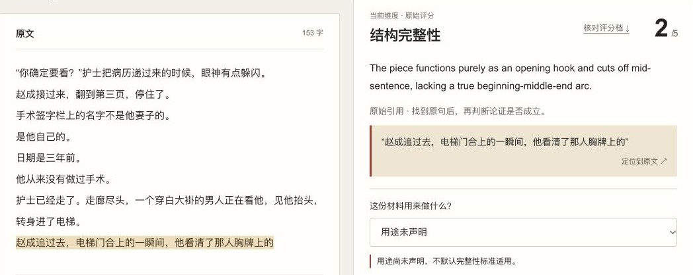
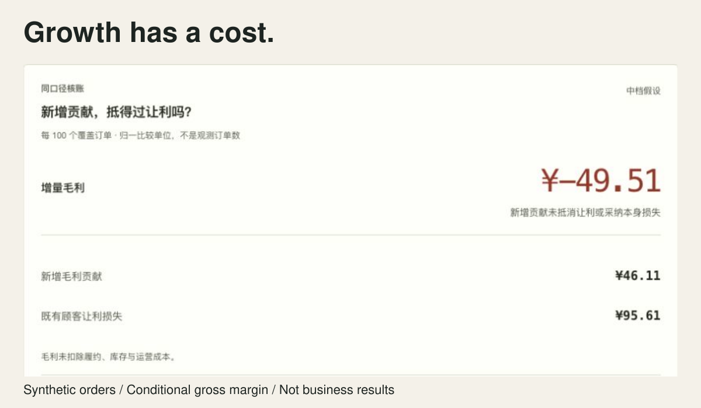
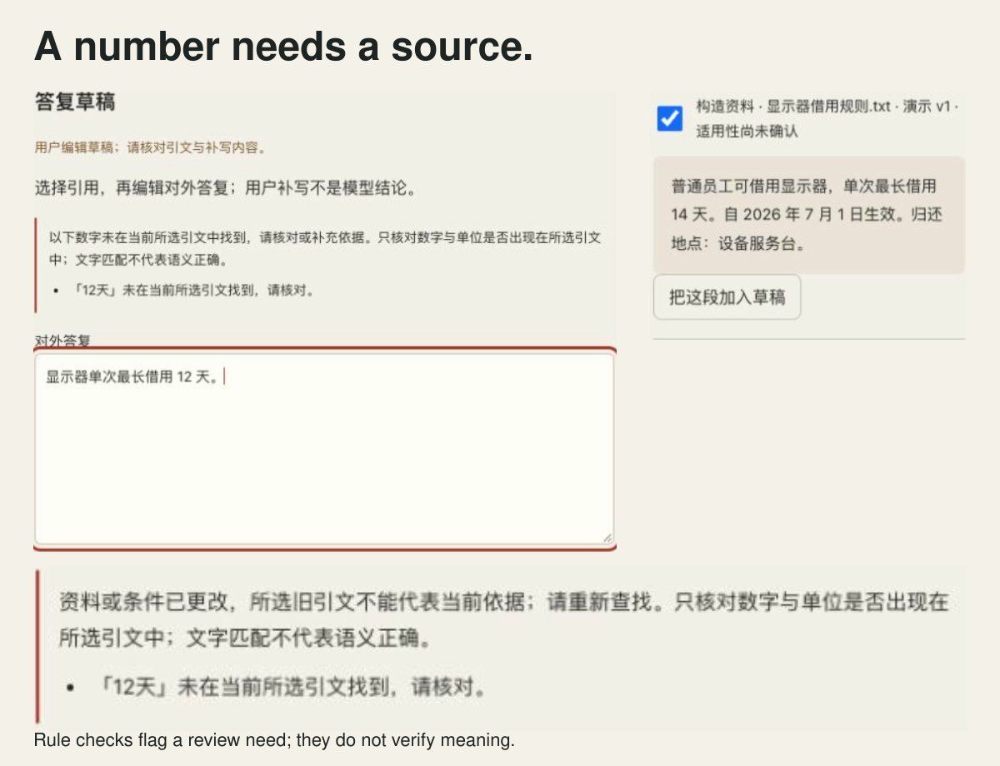

<picture>
  <source media="(max-width: 600px) and (prefers-color-scheme: dark)" srcset="assets/editorial/cover-narrow-dark.svg">
  <source media="(max-width: 600px)" srcset="assets/editorial/cover-narrow-light.svg">
  <source media="(prefers-color-scheme: dark)" srcset="assets/editorial/cover-dark.svg">
  
</picture>

**Andy Zhang · AI product manager.** I build creative agents, evaluation tools and growth experiments. Try making one decision in each of these tools.

[中文](README.md) · [Portfolio](https://andyzhang666666.github.io/) · [Résumés (3 PDFs in Chinese)](https://andyzhang666666.github.io/#resumes) · [Project index](PROJECTS.en.md)

**AI products** · [Find the sentence behind a 2/5 score](https://andyzhang666666.github.io/llm-output-eval/?sample=e06&dimension=structure) · Historical replay · [Review design](https://github.com/AndyZhang666666/llm-output-eval/pull/5)

**Growth** · [Conversion went up. Would you roll it out?](https://andyzhang666666.github.io/growth-experiment-lab/#read) · Synthetic A/B test · [Decision rules](https://github.com/AndyZhang666666/growth-experiment-lab/blob/main/docs/DECISIONS.md)

**Pricing** · [Move the discount from 6% to 8% and check the margin](https://andyzhang666666.github.io/bundle-lab/simulate/) · Synthetic orders · [Ledger design](https://github.com/AndyZhang666666/bundle-lab/pull/5)

## Eval Lab · Does a cut-off sentence justify a low score?

A suspense scene ends just as the protagonist reads a name badge. The historical reviewer gave structure 2/5. The sentence really is unfinished. Should a complete-story rubric apply if the author only intended an opening?

<picture>
  <source media="(max-width: 600px)" srcset="assets/editorial/e06-review-narrow.jpg">
  
</picture>

I keep the original score alongside a separate human review. Someone can challenge the rubric and the next reviewer can still trace the original decision.

[Review this verdict](https://andyzhang666666.github.io/llm-output-eval/?sample=e06&dimension=structure) · [How review works](docs/editorial/projects/eval.md)

A separate task: [watch a 7-second human review and revision](docs/editorial/replay/eval-task-7s.gif) using a constructed draft. The sequence shows manual edits.

## Three more design decisions

### TasteRoom · Preference scopes

Where should a layout preference apply? Try the same copy in a personal and a work context. A rule enters that context only when you choose to save it.

<picture>
  <source media="(prefers-color-scheme: dark)" srcset="assets/editorial/taste-dark.svg">
  
</picture>

[Try it](https://andyzhang666666.github.io/tasteroom/) · [Design and implementation](docs/editorial/projects/taste.md)

### Bundle Lab · The promotion ledger

Existing buyers can claim the discount too. Keep adoption fixed and try 6% and 8% on the built-in orders. The ledger shows new contribution and discounts to existing buyers per 100 covered orders. In the mid-adoption scenario, margin moves from +¥13.44 to −¥7.54, before fulfilment and operating costs.

<picture>
  <source media="(prefers-color-scheme: dark)" srcset="assets/editorial/bundle-dark.svg">
  
</picture>

[Try it](https://andyzhang666666.github.io/bundle-lab/simulate/) · [Design and implementation](docs/editorial/projects/bundle.md)

### RAG Lab · When evidence expires

The policy says 14 days and the draft says 12. Check the source, then change the business date: previously selected evidence needs another review before export. The demo retrieves constructed material in the browser.

<picture>
  <source media="(max-width: 600px) and (prefers-color-scheme: dark)" srcset="assets/editorial/rag-narrow-dark.svg">
  <source media="(max-width: 600px)" srcset="assets/editorial/rag-narrow-light.svg">
  <source media="(prefers-color-scheme: dark)" srcset="assets/editorial/rag-dark.svg">
  
</picture>

[Try it](https://andyzhang666666.github.io/rag-lab/) · [Design and implementation](docs/editorial/projects/rag.md)

## Recent releases · 2026

- **11.15**　Renovation planner. A stale cache made the project card disappear after loading. The entry was fixed and rechecked from the portfolio. [Release](https://github.com/AndyZhang666666/AndyZhang666666.github.io/pull/13)
- **11.13**　Eval. After checking a quote on a phone, the reader can return to the same verdict. [Release](https://github.com/AndyZhang666666/llm-output-eval/pull/6)
- **11.13**　Bundle. Preview a cell in the discount matrix before applying its assumptions. [Release](https://github.com/AndyZhang666666/bundle-lab/pull/5)

## Experience and other work

At Shanhai I worked on creative agents and reusable skills. At Baidu Wenku I worked on AI features, and at Keeta on international growth. One search problem at Keeta was deciding when an Arabic transliteration matched a dish closely enough to show it.

More experience and research

My work included segmented subsidy experiments at Keeta, in-car interactions at Li Auto and subscription upgrades at Revolut. My MSc research at UCL explored order flow in intraday S&P 500 trading. At Bristol I built a wearable posture-monitoring project with phone feedback for exercise.

[Work history](https://andyzhang666666.github.io/#work) · [Cross-language search at Keeta](https://andyzhang666666.github.io/#evidence-search) · [Enterprise delivery](https://andyzhang666666.github.io/cases/agent-workflow/) · [Agent execution bench](https://andyzhang666666.github.io/agent-bench/) · [Browse all projects](PROJECTS.en.md)

[Contact](https://andyzhang666666.github.io/#contact) · [Image sources](docs/editorial/SOURCES.md)
