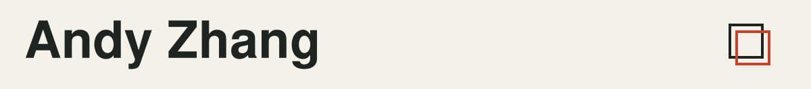
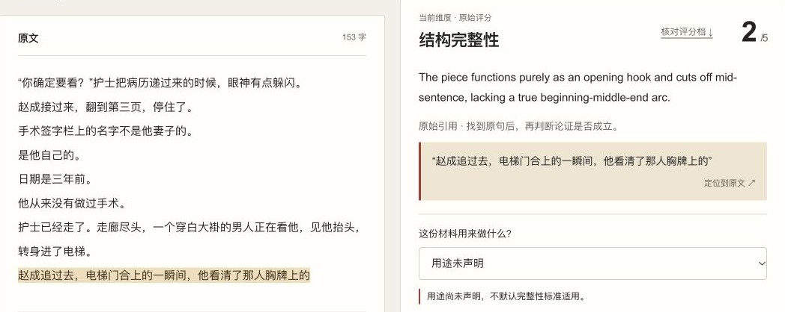
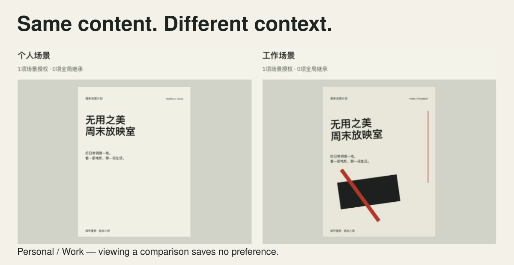
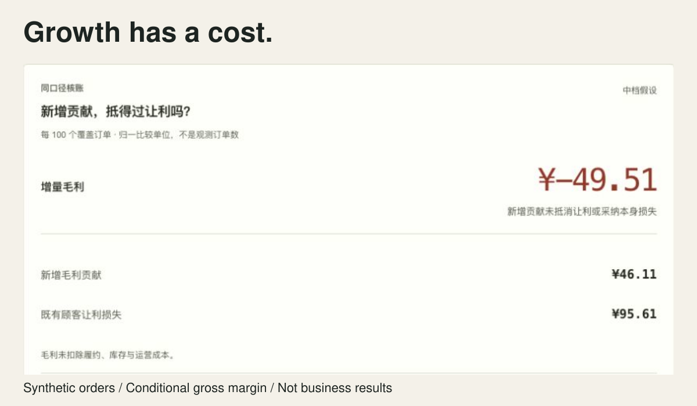
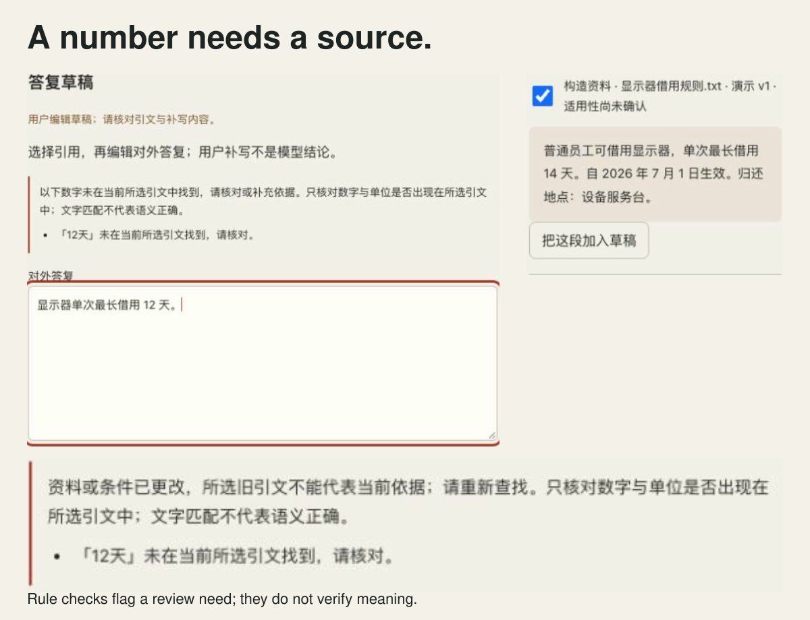

<picture>
  <source media="(max-width: 600px) and (prefers-color-scheme: dark)" srcset="assets/editorial/cover-narrow-dark.svg">
  <source media="(max-width: 600px)" srcset="assets/editorial/cover-narrow-light.svg">
  <source media="(prefers-color-scheme: dark)" srcset="assets/editorial/cover-dark.svg">
  
</picture>

**张千羽 · AI 产品经理**　我做创作 Agent、效果评测和增长实验。下面三个工具，各留了一个判断给你。

[English](README.en.md) · [个人网站](https://andyzhang666666.github.io/) · [全部作品](PROJECTS.md)

**AI 应用** · [点开 2/5 的评语，找到它引用的原句](https://andyzhang666666.github.io/llm-output-eval/?sample=e06&dimension=structure) · 历史回放 · [评分与复核](https://github.com/AndyZhang666666/llm-output-eval/pull/5)

**增长实验** · [转化率涨了，要全量上线吗？](https://andyzhang666666.github.io/growth-experiment-lab/#read) · 模拟实验 · [决策规则](https://github.com/AndyZhang666666/growth-experiment-lab/blob/main/docs/DECISIONS.md)

**定价策略** · [把折扣从 6% 调到 8%，看毛利变号](https://andyzhang666666.github.io/bundle-lab/simulate/) · 合成订单 · [账本实现](https://github.com/AndyZhang666666/bundle-lab/pull/5)

## Eval Lab · 半句话能支持一个低分吗？

悬疑开场停在“他看清了那人胸牌上的”。历史评语给结构完整性 2/5。原文确实断在这里，但如果作者只打算写一个开场，用完整短篇的标准扣分合适吗？

<picture>
  <source media="(max-width: 600px)" srcset="assets/editorial/e06-review-narrow.jpg">
  
</picture>

我把原始分数和人工意见分开保存。读者可以质疑量表，下一位审阅者仍能看到当初的原句和判断。

[复核这条评语](https://andyzhang666666.github.io/llm-output-eval/?sample=e06&dimension=structure) · [设计与实现](docs/editorial/projects/eval.md)

另一个场景：[看 7 秒人工审阅与改稿对照](docs/editorial/replay/eval-task-7s.gif)。使用构造文稿，全程人工操作。

## 另外三个设计取舍

### TasteRoom · 偏爱实验室

喜欢一种排版，应该记到哪里？同一段文字可以先在个人和工作两种场景试排。只有确认保存，规则才进入那个场景。

<picture>
  <source media="(prefers-color-scheme: dark)" srcset="assets/editorial/taste-dark.svg">
  
</picture>

[体验](https://andyzhang666666.github.io/tasteroom/) · [设计与实现](docs/editorial/projects/taste.md)

### Bundle Lab · 促销账本

每 100 笔覆盖订单，既有顾客也会拿走折扣。打开内置算例，保持采纳率不动，分别试 6% 和 8%。账本会把新增贡献和原有顾客让利分别列出。中档算例从 +¥13.44 变为 −¥7.54。这里算的是条件毛利，尚未扣履约和运营成本。

<picture>
  <source media="(prefers-color-scheme: dark)" srcset="assets/editorial/bundle-dark.svg">
  
</picture>

[体验](https://andyzhang666666.github.io/bundle-lab/simulate/) · [设计与实现](docs/editorial/projects/bundle.md)

### 可信 RAG · 依据的有效期

借用条款写 14 天，草稿写了 12 天。可以回到来源核对这两个数。业务日期改变后，已选依据还得重新确认，才能导出草稿。演示在浏览器内检索构造资料。

<picture>
  <source media="(max-width: 600px) and (prefers-color-scheme: dark)" srcset="assets/editorial/rag-narrow-dark.svg">
  <source media="(max-width: 600px)" srcset="assets/editorial/rag-narrow-light.svg">
  <source media="(prefers-color-scheme: dark)" srcset="assets/editorial/rag-dark.svg">
  
</picture>

[体验](https://andyzhang666666.github.io/rag-lab/) · [设计与实现](docs/editorial/projects/rag.md)

## 最近交付 · 2026

- **11.15**　安心装修。旧缓存让新作品卡片出现后又消失，修复后从官网重新走通入口。 [发布记录](https://github.com/AndyZhang666666/AndyZhang666666.github.io/pull/13)
- **11.13**　Eval。手机用户核对引文后，可以回到同一条评语继续复核。 [发布记录](https://github.com/AndyZhang666666/llm-output-eval/pull/6)
- **11.13**　Bundle。可以在折扣矩阵里预演一个方案，再决定是否采用。 [发布记录](https://github.com/AndyZhang666666/bundle-lab/pull/5)

## 工作与其他作品

在山海星辰做创作 Agent 与可复用 Skill，在百度参与文库 AI 产品，在 Keeta 做海外用户增长。工作中遇到的检索、定价与评测问题，也是我做这些独立工具的起点。

更多经历与研究背景

在 Keeta 做分层补贴实验，在理想汽车参与智能座舱交互，在 Revolut 参与订阅权益与升级流程。UCL 硕士期间研究标普 500 订单流与日内交易；Bristol 本科毕设把运动姿态监测与手机端反馈结合起来。

[工作经历](https://andyzhang666666.github.io/#work) · [Keeta 增长经历](https://andyzhang666666.github.io/#work-keeta) · [企业工具交付](https://andyzhang666666.github.io/cases/agent-workflow/) · [Agent 执行评测](https://andyzhang666666.github.io/agent-bench/) · [按方向找作品](PROJECTS.md)

[联系我](https://andyzhang666666.github.io/#contact) · [素材与版本](docs/editorial/SOURCES.md)
