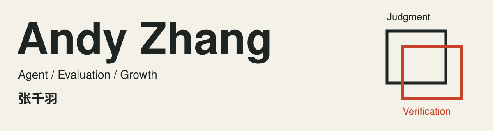
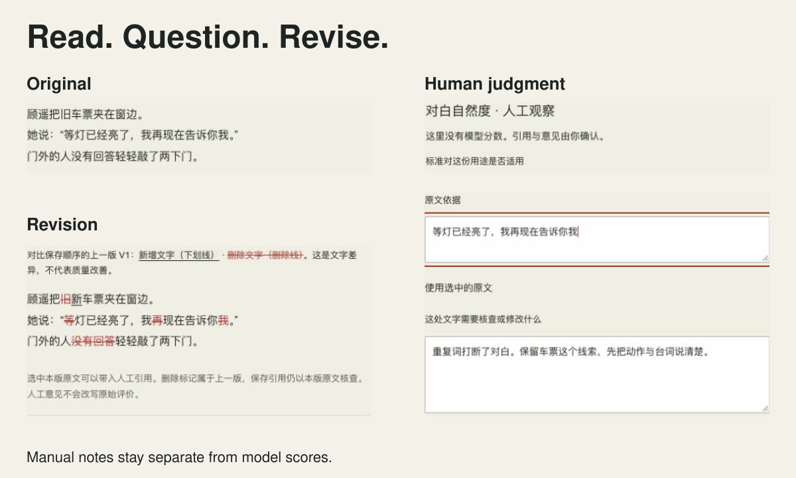
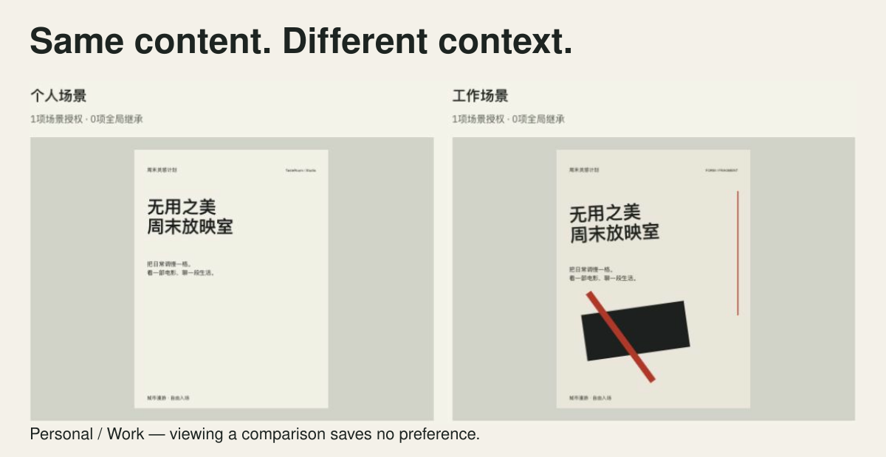
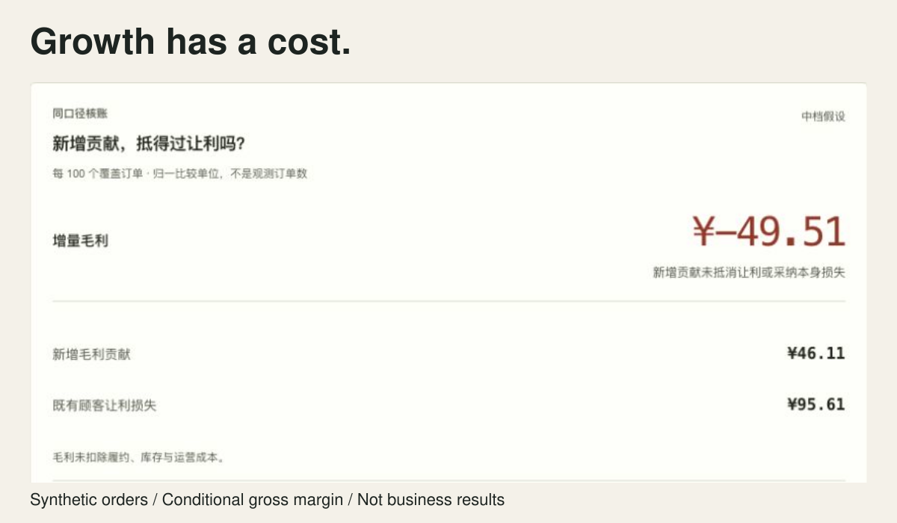
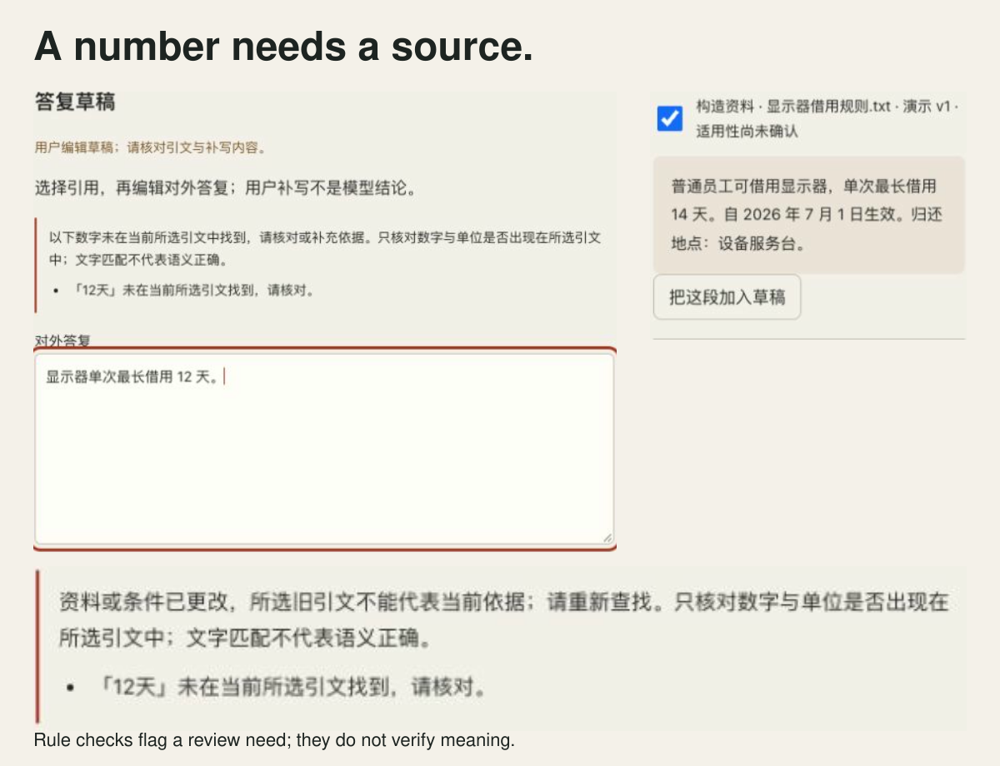

<picture>
  <source media="(max-width: 600px) and (prefers-color-scheme: dark)" srcset="assets/editorial/cover-narrow-dark.svg">
  <source media="(max-width: 600px)" srcset="assets/editorial/cover-narrow-light.svg">
  <source media="(prefers-color-scheme: dark)" srcset="assets/editorial/cover-dark.svg">
  
</picture>

**张千羽 · AI 产品经理，做 Agent、效果评测和商业增长。**

我把业务问题做成可操作的产品，再核对它是否解决了问题。

[官网与完整体验](https://andyzhang666666.github.io/) · [产品简历](https://andyzhang666666.github.io/assets/resume.pdf) · [English](README.en.md) · [全部项目](PROJECTS.md)

## Eval Lab

**改稿之后，判断还能对得上吗？**

对照原稿与修改稿，检查逐字增删，再带走当前版本的送评任务包。

<picture>
  <source media="(max-width: 600px) and (prefers-color-scheme: dark)" srcset="assets/editorial/eval-narrow-dark.svg">
  <source media="(max-width: 600px)" srcset="assets/editorial/eval-narrow-light.svg">
  <source media="(prefers-color-scheme: dark)" srcset="assets/editorial/eval-dark.svg">
  
</picture>

**找到引用后，还要判断评语是否成立。** 模型原分与人工意见分别保存，修改后的稿件也保留自己的审阅上下文。

图中是构造文稿的人工审阅与版本对照，没有调用模型；历史输出另行回放。

[体验](https://andyzhang666666.github.io/llm-output-eval/workspace/) · [设计与实现](docs/editorial/projects/eval.md)

[观看 7 秒任务回放](docs/editorial/replay/eval-task-7s.gif)

## 三个精选

### 偏爱实验室 · TasteRoom

同一份内容，换到工作场景还适用吗？对照同文同图在个人与工作规则下的构图，再决定偏好应该保存在哪个范围。

<picture>
  <source media="(prefers-color-scheme: dark)" srcset="assets/editorial/taste-dark.svg">
  
</picture>

**查看和临时试用，不自动成为长期偏好。** 保存需要明确确认与适用范围。

本机设计规则演示；查看对照不写入偏好记忆。

[体验](https://andyzhang666666.github.io/tasteroom/) · [设计与实现](docs/editorial/projects/taste.md)

### Bundle Lab

多卖一份套餐，就会多赚吗？从商品或 CSV 输入建立基线，把新增贡献、既有顾客让利和毛利变化放进同一账本，再冻结后续观察计划。

<picture>
  <source media="(prefers-color-scheme: dark)" srcset="assets/editorial/bundle-dark.svg">
  
</picture>

**新增购买可能抵不过让利。** 后续观察按冻结计划核对，不跟着当前输入移动门槛。

合成订单或自有输入的条件推演；毛利变化不包含履约及运营等成本，不代表已验证的业务收益。

[体验](https://andyzhang666666.github.io/bundle-lab/simulate/) · [设计与实现](docs/editorial/projects/bundle.md)

### 可信 RAG 实验台

答复里的数字，能回到哪条依据？导入资料、选择引用、人工编辑草稿，再检查数字及日期、身份变化后的依据范围。

<picture>
  <source media="(max-width: 600px) and (prefers-color-scheme: dark)" srcset="assets/editorial/rag-narrow-dark.svg">
  <source media="(max-width: 600px)" srcset="assets/editorial/rag-narrow-light.svg">
  <source media="(prefers-color-scheme: dark)" srcset="assets/editorial/rag-dark.svg">
  
</picture>

**数字匹配是核查线索，资料范围变化后需要重新确认答复。** 提示不替代语义判断。

浏览器本机检索、规则核查与人工草稿；默认不调用模型。

[体验](https://andyzhang666666.github.io/rag-lab/) · [设计与实现](docs/editorial/projects/rag.md)

## 最近交付

- **2026-11-11 · Eval** — 保存修改版本、核对逐字增删，复制本版送评任务包；存疑依据可整理为校准备忘草稿。[发布记录](https://github.com/AndyZhang666666/llm-output-eval/pull/5)
- **2026-11-11 · Bundle** — 调整既有顾客领折扣的假设，将矩阵预演存成方案，用观察计数核对冻结计划的保本门槛。[发布记录](https://github.com/AndyZhang666666/bundle-lab/pull/4)
- **2026-11-11 · 偏爱 / RAG** — 增加同文同图的场景授权对照、草稿数字核查，以及日期与身份变化前后的依据范围对照。[发布记录](https://github.com/AndyZhang666666/AndyZhang666666.github.io/pull/8)

## 经历与其他作品

工作经历、业务结果与研究背景

在山海星辰负责创作 Agent 与 Skill 资产：上线 38 个 Skill，工具月均调用约 6,000 次，单剧创作耗时缩短约 30%。在百度实习时参与 AI 功能从 0 到 1，上线两周日活破万；在美团 Keeta 的增长实习中，分层补贴实验使新客获客成本降低 27%，新客月留存提升 8%。也有理想汽车智能座舱和 Revolut 订阅产品的实习经历。

[具体职责与结果口径](https://andyzhang666666.github.io/#work) · [产品简历](https://andyzhang666666.github.io/assets/resume.pdf)

上面是工作经历中的业务结果；这里的公开代码是独立作品。演示资料、历史模型输出和条件模拟在项目中分别标明，不包含公司内部代码或业务数据。Agent / RAG 的公开站点分别为程序记录回放和浏览器检索，真实模型接入需自行配置。

UCL 硕士 · Bristol 电子电气工程本科。研究过订单流日内量化模型，也做过面向运动场景的可穿戴姿态监测与手机交互。

完整目录保留 Agent 执行评测、其他评测工具、随便局、有据、增长与定价、通勤、扑克及产品分析等作品。

[AI / Agent 与评测](PROJECTS.md#ai--agent-与评测) · [生活与创新](PROJECTS.md#生活与创新) · [增长与商业化](PROJECTS.md#增长与商业化) · [日常决策与建模](PROJECTS.md#日常决策与建模) · [产品分析与历史版本](PROJECTS.md#产品分析与历史版本)

[联系我](https://andyzhang666666.github.io/#contact) · [English](README.en.md) · [按方向浏览全部项目](PROJECTS.md)

[素材与版本记录](docs/editorial/SOURCES.md)
