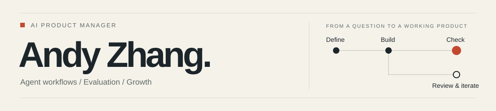

<picture>
  <source media="(prefers-color-scheme: dark)" srcset="assets/profile-dark.svg">
  
</picture>

# 张千羽 · Andy Zhang

**AI 产品经理，做 Agent、效果评测和商业增长。**

我把业务问题做成可操作的产品，再核对它是否解决了问题。下面四个作品，分别展示评测、偏好、商业判断和证据整理中的设计取舍。

[官网与完整体验](https://andyzhang666666.github.io/) · [产品简历](https://andyzhang666666.github.io/assets/resume.pdf) · [English](README.en.md) · [全部项目](PROJECTS.md)

## 从这里开始

<table>
<tr>
<td width="50%" valign="top">

<strong>Eval Lab</strong> 改稿之后，怎样保留判断依据？

对照原稿与修改稿，核对增删，再带走当前版本的送评任务包。

人工审阅 / 历史输出分开保存 <a href="https://andyzhang666666.github.io/llm-output-eval/workspace/">体验</a> · <a href="https://github.com/AndyZhang666666/llm-output-eval/blob/main/docs/TASK-LOOPS-20261111.md">设计过程</a> · <a href="https://github.com/AndyZhang666666/llm-output-eval">源码</a> · <a href="https://github.com/AndyZhang666666/llm-output-eval/blob/af60f5b096bfd4e09ef0e5c94d5f8a93f44a1b40/docs/assets/task-loops-20261111/static/workspace-diff-1280.png">大图</a>

</td>
<td width="50%" valign="top">

<strong>偏爱实验室 · TasteRoom</strong> 喜欢这张海报，要记到哪个场景？

用同一份文案与主图对照个人、工作规则，再明确决定偏好范围。

本机设计规则 / 查看对照不写记忆 <a href="https://andyzhang666666.github.io/tasteroom/">体验</a> · <a href="https://github.com/AndyZhang666666/AndyZhang666666.github.io/blob/main/tasteroom/docs/TASK-LOOP-20261111.md">设计过程</a> · <a href="https://github.com/AndyZhang666666/AndyZhang666666.github.io/tree/main/tasteroom">源码</a> · <a href="https://github.com/AndyZhang666666/AndyZhang666666.github.io/blob/174399eef34fcdaae22926585dcf9066d1a283bb/tasteroom/docs/evidence/task-loop-20261111/scene-desktop.png">大图</a>

</td>
</tr>
<tr>
<td width="50%" valign="top">

<strong>Bundle Lab</strong> 套餐卖得更多，为什么可能少赚？

从自己的商品或 CSV 建立基线，拆开新增贡献与既有让利，再冻结验证计划。

合成订单 / 自有输入 / 条件推演 <a href="https://andyzhang666666.github.io/bundle-lab/simulate/">体验</a> · <a href="https://github.com/AndyZhang666666/bundle-lab/blob/main/docs/TASK-LOOP-20261111.md">设计过程</a> · <a href="https://github.com/AndyZhang666666/bundle-lab">源码</a> · <a href="https://github.com/AndyZhang666666/bundle-lab/blob/062b6563a9e587c27040f6fc596184f58d0407b3/docs/assets/task-loop-20261111/workspace-1280.png">大图</a>

</td>
<td width="50%" valign="top">

<strong>可信 RAG 实验台</strong> 答复里的数字，能回到哪条依据？

导入自己的资料，选择引用、编辑答复，核对数字与日期、权限变化。

本机检索与人工草稿 / 默认不调用模型 <a href="https://andyzhang666666.github.io/rag-lab/">体验</a> · <a href="https://github.com/AndyZhang666666/AndyZhang666666.github.io/blob/main/rag-lab/docs/TASK-LOOP-20261111.md">设计过程</a> · <a href="https://github.com/AndyZhang666666/AndyZhang666666.github.io/tree/main/rag-lab">源码</a> · <a href="https://github.com/AndyZhang666666/AndyZhang666666.github.io/blob/174399eef34fcdaae22926585dcf9066d1a283bb/rag-lab/evidence/task-loop-20261111/rag-1280-grounding.png">大图</a>

</td>
</tr>
</table>

截图来自 2026-11-11 的真实界面与构造验收材料。体验入口打开当前产品；截图固定到对应源码版本。[素材来源](docs/assets/featured-sources-20261112.json)

## 最近交付

| 日期 | 已发布的变化 | 实现记录 |
| --- | --- | --- |
| 2026-11-11 | Eval：保存修改版本、核对逐字增删、复制本版送评任务包；存疑依据可整理为量表校准备忘草稿。 | [Eval PR #5](https://github.com/AndyZhang666666/llm-output-eval/pull/5) |
| 2026-11-11 | Bundle：调整既有顾客领折扣的假设，将矩阵预演存成方案，用观察计数核对冻结计划的保本门槛。 | [Bundle PR #4](https://github.com/AndyZhang666666/bundle-lab/pull/4) |
| 2026-11-11 | 偏爱支持同文同图的场景授权对照；RAG 增加草稿数字核查和日期、身份变化前后的依据范围对照。 | [产品发布 PR #8](https://github.com/AndyZhang666666/AndyZhang666666.github.io/pull/8) · [RAG 资源版本补丁 #9](https://github.com/AndyZhang666666/AndyZhang666666.github.io/pull/9) |

## 我在这些产品里作的判断

**找到引句，还要核对评语。** Eval 将模型原分、用途适用性和人工意见分别保留。排除不适用维度后的参考均分另列；校准备忘只是一份待审阅草稿。[看设计依据](https://github.com/AndyZhang666666/llm-output-eval/blob/main/docs/TASK-LOOPS-20261111.md)

**查看一个可能性，不等于同意记住它。** 偏爱的个人/工作对照只读；关闭后，原画布、未应用文案和已保存偏好都还在。临时试用也要经过明确确认，才形成长期规则。[看授权设计](https://github.com/AndyZhang666666/AndyZhang666666.github.io/blob/main/tasteroom/docs/TASK-LOOP-20261111.md)

**验证计划要保留当时的条件。** Bundle 用冻结计划的保本点核对后来的观察，当前工作输入的变化不会改写基准。未知值保持未知；达到门槛之后，仍需作推广判断。[看账本与验证设计](https://github.com/AndyZhang666666/bundle-lab/blob/main/docs/TASK-LOOP-20261111.md)

## 继续看其他方向

[Agent 执行评测台](https://andyzhang666666.github.io/agent-bench/)检查响应丢失、权限和重复写入；[Filing Eval](https://github.com/AndyZhang666666/filing-eval)把事实错误与重要遗漏分开复核。[增长实验](https://github.com/AndyZhang666666/growth-experiment-lab)和[付费机制模拟](https://github.com/AndyZhang666666/pricing-model-sim)继续检查证据能否支持业务决策。

[随便局](https://andyzhang666666.github.io/suibianju/)、[有据](https://andyzhang666666.github.io/grounded-choice/)、[通勤比较器](https://github.com/AndyZhang666666/commute-compare)与[扑克实验](PROJECTS.md#日常决策与建模)保留在分类索引里。[AI 产品拆解](https://github.com/AndyZhang666666/ai-product-teardowns)记录能力边界、失败处理与付费点；[Creative Eval](https://github.com/AndyZhang666666/creative-eval)保留第一版的校准过程与历史结果。

## 工作中的产品实践

在山海星辰负责创作 Agent 与 Skill 资产：上线 38 个 Skill，工具月均调用约 6,000 次，单剧创作耗时缩短约 30%。在百度实习时参与 AI 功能从 0 到 1，上线两周日活破万；在美团 Keeta 的增长实习中，分层补贴实验使新客获客成本降低 27%，新客月留存提升 8%。也有理想汽车智能座舱和 Revolut 订阅产品的实习经历。

[具体职责与结果口径](https://andyzhang666666.github.io/#work) · [产品简历](https://andyzhang666666.github.io/assets/resume.pdf)

上面是工作经历中的业务结果；这里的公开代码是独立作品。演示资料、历史模型输出和条件模拟在项目中分别标明，不包含公司内部代码或业务数据。Agent / RAG 的公开站点分别为程序记录回放和浏览器检索，真实模型接入需自行配置。

UCL 硕士 · Bristol 电子电气工程本科。研究过订单流日内量化模型，也做过面向运动场景的可穿戴姿态监测与手机交互。

[联系我](https://andyzhang666666.github.io/#contact) · [English](README.en.md) · [按方向浏览全部项目](PROJECTS.md)
