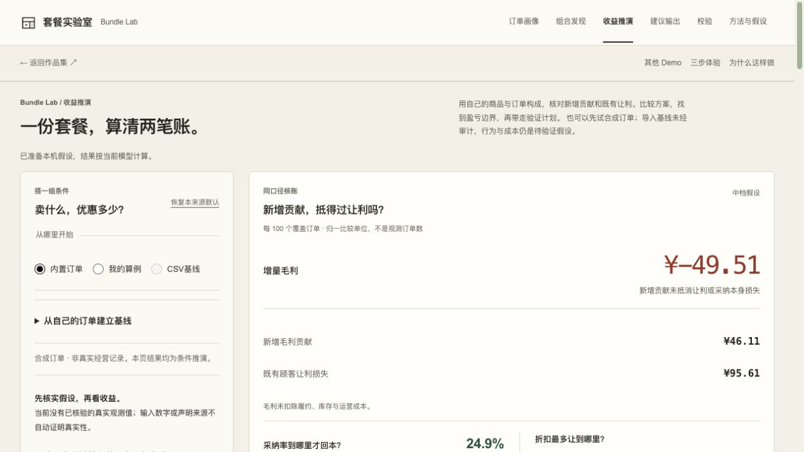

# Bundle Lab · 设计与实现 / Design & implementation

套餐卖得更多，为什么仍可能少赚？本组使用内置可乐与鸡腿饭合成订单：折扣 12%、中档新增采纳率 12%、既有顾客领折扣 100%，按每 100 个覆盖订单归一化。

设计取舍：把新增毛利贡献 ¥46.11 与既有让利损失 ¥95.61 分开，界面增量毛利为 −¥49.51。三项独立四舍五入，保留原值；毛利不含履约、库存和运营成本。这是条件推演，不是观测收益或净利润；后续验证应与冻结计划对照。

Can selling more earn less? Synthetic cola and chicken-leg-rice orders use a 12% discount, 12% new adoption and 100% existing-customer discount take-up. New contribution and discount loss share one ledger. Values are rounded independently; the displayed total is preserved. This is a conditional margin calculation, excluding fulfilment, inventory and operating costs, not observed returns or net profit.

[公开体验 / Try it](https://andyzhang666666.github.io/bundle-lab/simulate/) · [固定版本源码 / Source](https://github.com/AndyZhang666666/bundle-lab/tree/062b6563a9e587c27040f6fc596184f58d0407b3) · [11/11 任务与验证记录 / Task-loop record](https://github.com/AndyZhang666666/bundle-lab/blob/062b6563a9e587c27040f6fc596184f58d0407b3/docs/TASK-LOOP-20261111.md)

## 完整截图 / Full viewport capture

2026-11-12 重新操作截取。原图未修改；[输入、版本与 SHA-256](../SOURCES.md)。Captured on 2026-11-12; original JPEG retained unchanged.

