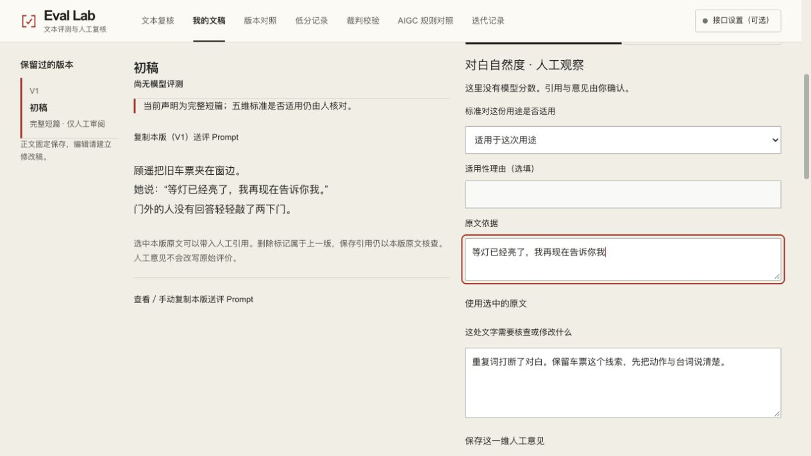
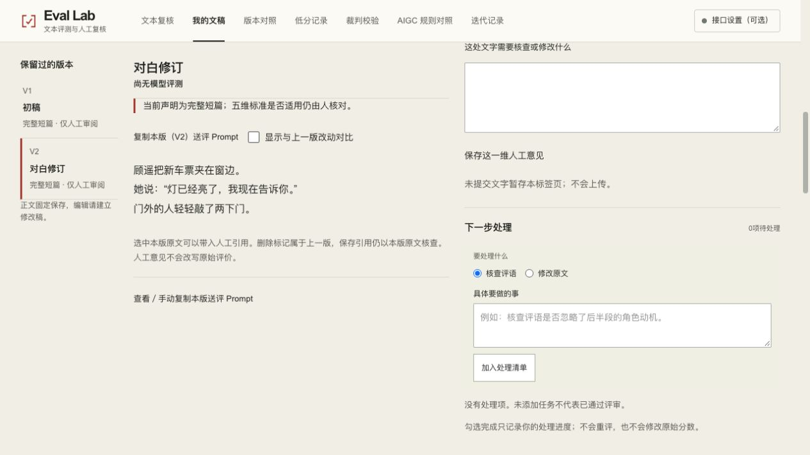
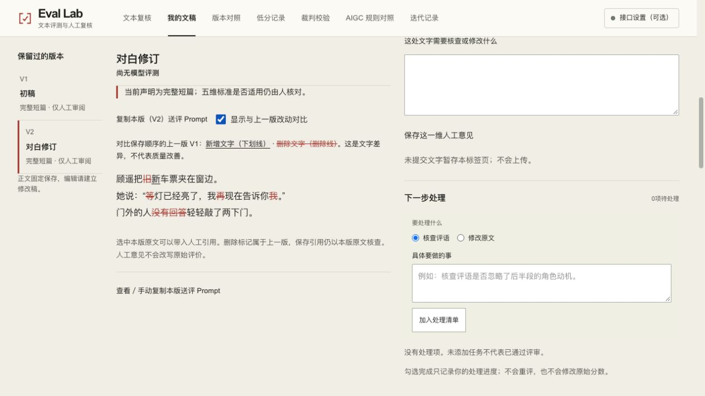

# Eval Lab · 设计与实现 / Design & implementation

改稿之后，原来的评语是否仍有依据？这次用一份 50 字构造短篇，先在 V1 保存对白引用与人工意见，再建立 V2，并查看逐字增删。

设计取舍：把引用、人工判断与文稿版本联系起来，保留模型原分与人工意见的边界，而不是覆盖一个总分。本组截图没有模型评测或分数；人工观察不证明模型效果。

After a rewrite, does the original judgement still hold? A constructed 50-character draft moves from a quoted human observation to a revision and an exact diff. Version context stays visible. These captures contain human review, not model scores or evidence of model quality.

[公开体验 / Try it](https://andyzhang666666.github.io/llm-output-eval/workspace/) · [固定版本源码 / Source](https://github.com/AndyZhang666666/llm-output-eval/tree/af60f5b096bfd4e09ef0e5c94d5f8a93f44a1b40) · [11/11 任务与验证记录 / Task-loop record](https://github.com/AndyZhang666666/llm-output-eval/blob/af60f5b096bfd4e09ef0e5c94d5f8a93f44a1b40/docs/TASK-LOOPS-20261111.md)

## 手动回放 / Manual replay

[打开 7 秒任务回放 / Open the 7-second replay](../replay/eval-task-7s.gif)

由下方三张真实操作截图编码，展示人工意见、修改稿与逐字对照三个状态；不是连续录像，不测量系统延迟。Encoded from the three captured states below; not a continuous recording or a latency measurement.

## 完整截图 / Full viewport captures

2026-11-12 重新操作截取。原图未修改；[输入、版本与 SHA-256](../SOURCES.md)。Captured on 2026-11-12; original JPEGs retained unchanged.

### V1 · 人工意见 / Human observation

### V2 · 修改稿 / Revision

### V1 → V2 · 逐字对照 / Exact diff

