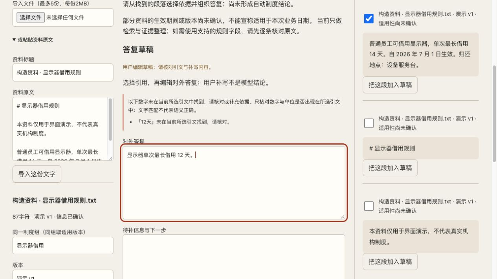
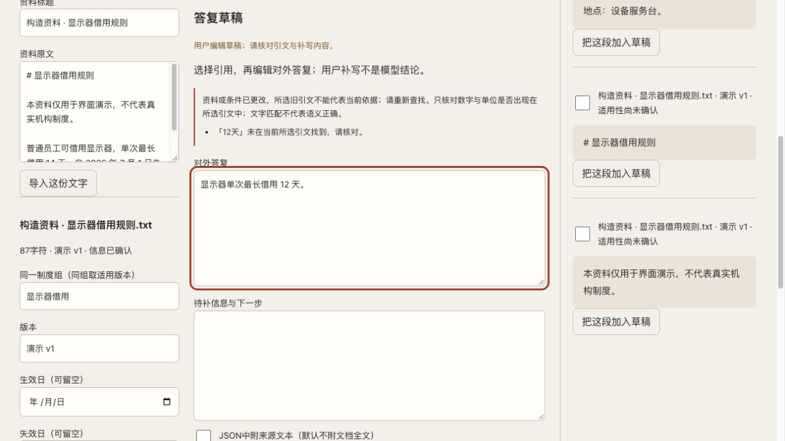

# 可信 RAG · 设计与实现 / Design & implementation

答复中的数字能否回到原文，原文是否仍适用？本组粘贴构造资料，借用上限写 14 天；人工草稿写 12 天。随后把业务日期从 2026-10-28 改为 2026-11-12，旧依据提示重查，重新确认适用性前禁止导出。

设计取舍：数字匹配只提供核查线索；检索到文字不等于语义正确，条件变化后也不能继续默认引用有效。本次只有浏览器本机检索、规则核查与人工编辑，没有模型调用或模型生成结论。

Which source supports a number, and does that source still apply? A constructed policy states 14 days; the human-edited draft says 12. Changing the business date flags old evidence for review and blocks export until applicability is reconfirmed. Local retrieval and rule checks provide clues, not semantic certification. No model was called.

[公开体验 / Try it](https://andyzhang666666.github.io/rag-lab/) · [固定版本源码 / Source](https://github.com/AndyZhang666666/AndyZhang666666.github.io/tree/174399eef34fcdaae22926585dcf9066d1a283bb/rag-lab) · [11/11 任务与验证记录 / Task-loop record](https://github.com/AndyZhang666666/AndyZhang666666.github.io/blob/174399eef34fcdaae22926585dcf9066d1a283bb/rag-lab/docs/TASK-LOOP-20261111.md)

## 完整截图 / Full viewport captures

2026-11-12 重新操作截取。原图未修改；[输入、版本与 SHA-256](../SOURCES.md)。Captured on 2026-11-12; original JPEGs retained unchanged.

### 数字核查 / Number check

### 条件变化 / Changed conditions

