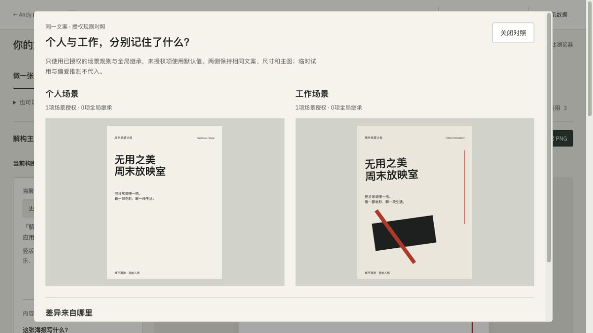

# 偏爱实验室 · TasteRoom

同一个人喜欢的设计，应该在哪个场景生效？本组用相同默认文案与主图：个人场景有一条字体授权、使用默认瑞士构图；工作场景明确授权一条解构主义规则。

设计取舍：把查看、临时试用与长期保存分开。场景对照只读，打开对照不写入偏好记忆；画面差异是本机规则与授权范围的结果，不代表系统自动理解了人的审美。

Where should a preference apply? The same copy and image are shown under personal and work rules. Personal scope has one font rule and the default Swiss layout; work scope explicitly authorises deconstruction. Comparison is read-only. Viewing a design does not save a lasting preference or establish that the system understands someone's taste.

[公开体验 / Try it](https://andyzhang666666.github.io/tasteroom/) · [固定版本源码 / Source](https://github.com/AndyZhang666666/AndyZhang666666.github.io/tree/174399eef34fcdaae22926585dcf9066d1a283bb/tasteroom) · [11/11 任务与验证记录 / Task-loop record](https://github.com/AndyZhang666666/AndyZhang666666.github.io/blob/174399eef34fcdaae22926585dcf9066d1a283bb/tasteroom/docs/TASK-LOOP-20261111.md)

## 完整截图 / Full viewport capture

2026-11-12 重新操作截取。两侧均为一条场景授权、零条全局继承。原图未修改；[输入、版本与 SHA-256](../SOURCES.md)。Captured on 2026-11-12; both scenes show one scoped rule and no global inheritance. Original JPEG retained unchanged.

